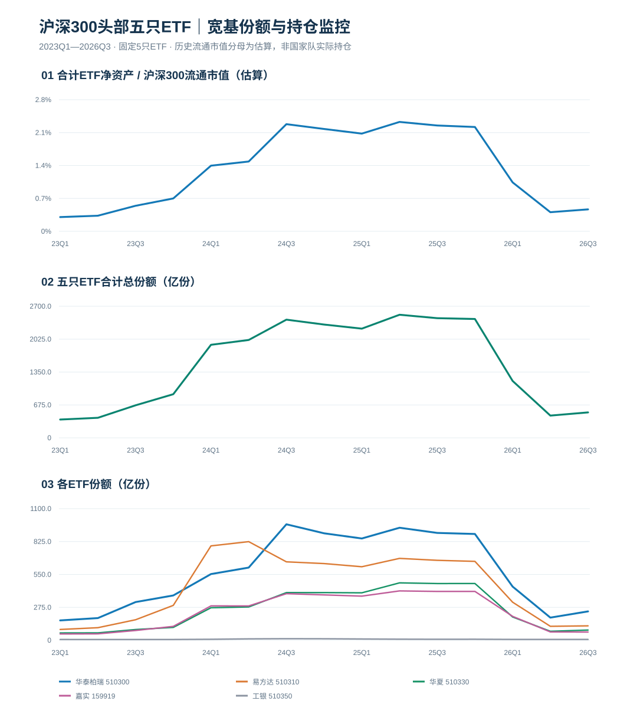

# 沪深300头部ETF｜国家队宽基持仓与潜在抛压监控

**已建档数据日期：2026-09-30（季度披露）。** 更新这份文档的数据不是实时交易行情，也**不是国家队实时持仓**。

## 四个监控模块

1. **合计规模占流通市值**：5只基金的季度**净资产**加总，再除以同期**沪深300流通市值估算**。历史分母根据公开锚点及指数点位推算，不是逐季官方实测。
2. **五只ETF份额合计**：追踪份额本身，而不是把市值波动误判为净申赎。跨ETF份额直接相加仅用于看活动，不等于可比的货币金额。
3. **各ETF份额结构**：510300、510310、510330、159919、510350同一固定样本长期观察；非未来任意时点的最新前五大。
4. **中央汇金披露持仓校准**：仅记录明确披露的中央汇金投资/资产管理持有份额，缺失者留空，不能用所有机构持有代替。

## 最新一期（2026Q3）

- 五只ETF合计净资产：**2,328.97亿元**。
- 五只ETF合计份额：**522.02亿份**，较2026Q2增加**65.34亿份**；较2025Q4的2,438.52亿份明显减少。
- 规模/沪深300流通市值估算值：**0.467%**。精确占比待补全部季度流通市值原始值。

## 季度数据（基金净资产：亿元；份额：亿份）

各只ETF份额依次为 华泰柏瑞 / 易方达 / 华夏 / 嘉实 / 工银瑞信。

| 季度 | 合计净资产 | 合计份额 | 规模/流通市值（估算） | 五只ETF份额 |
|---|---:|---:|---:|---|
| 23Q1 | 1335.1 | 375.69 | 0.303% | 165.77 / 90.05 / 60.94 / 52.46 / 6.47 |
| 23Q2 | 1388.4 | 411.29 | 0.332% | 185.22 / 104.85 / 61.53 / 53.47 / 6.22 |
| 23Q3 | 2182.2 | 667.77 | 0.543% | 319.16 / 171.29 / 89.44 / 81.52 / 6.36 |
| 23Q4 | 2612.4 | 895.59 | 0.700% | 374.44 / 291.41 / 107.43 / 115.95 / 6.36 |
| 24Q1 | 5378.6 | 1909.02 | 1.397% | 553.29 / 788.77 / 271.73 / 287.14 / 8.09 |
| 24Q2 | 5595.5 | 2008.02 | 1.485% | 607.40 / 824.25 / 278.28 / 286.67 / 11.42 |
| 24Q3 | 9970.5 | 2424.98 | 2.280% | 969.22 / 655.46 / 398.12 / 389.22 / 12.96 |
| 24Q4 | 9326.0 | 2324.42 | 2.178% | 893.87 / 640.93 / 398.28 / 379.04 / 12.30 |
| 25Q1 | 8848.8 | 2240.52 | 2.079% | 850.60 / 614.36 / 396.41 / 368.76 / 10.39 |
| 25Q2 | 10110.7 | 2525.62 | 2.328% | 940.42 / 684.25 / 479.66 / 412.41 / 8.88 |
| 25Q3 | 11624.0 | 2455.37 | 2.252% | 897.16 / 668.09 / 473.94 / 408.07 / 8.11 |
| 25Q4 | 11523.3 | 2438.52 | 2.220% | 888.30 / 659.34 / 474.25 / 408.19 / 8.44 |
| 26Q1 | 5233.5 | 1167.18 | 1.041% | 448.29 / 317.88 / 194.38 / 199.65 / 6.98 |
| 26Q2 | 2305.8 | 456.68 | 0.407% | 189.15 / 116.45 / 74.89 / 69.39 / 6.80 |
| 26Q3 | 2329.0 | 522.02 | 0.467% | 241.20 / 120.32 / 85.07 / 68.66 / 6.77 |

## 2025年末中央汇金系持仓校准

| ETF | 2025年末披露的中央汇金直接持有（亿份） | 2026Q3 ETF全部份额（亿份） | 由总份额约束的原持仓减少下界（亿份） |
|---|---:|---:|---:|
| 510300 华泰柏瑞 | 735.13 | 241.20 | 493.93 |
| 510310 易方达 | 558.94 | 120.32 | 438.62 |
| 510330 华夏 | 420.28 | 85.07 | 335.21 |
| 159919 嘉实 | 354.98 | 68.66 | 286.32 |
| 510350 工银瑞信 | **未核实** | 6.77 | **不推断** |

**重要**：这里的“减少下界”只是“2025年末披露持有份额－2026Q3全部基金剩余份额”的数学界限（假设份额未拆分合并），**不等于当前汇金实际持仓，也不是每期精准赎回数额**。若同一主体经由资管计划间接持有，与上表直接持仓不能简单加总。

## 公共数据与维护

- 5只ETF季度份额/净资产：[510300](https://fund.10jqka.com.cn/510300/holder.html)、[510310](https://fund.10jqka.com.cn/510310/holder.html)、[510330](https://fund.10jqka.com.cn/510330/holder.html)、[159919](https://fund.10jqka.com.cn/159919/holder.html)、[510350份额](https://q.fund.sohu.com/q/qc.php?code=510350)、[510350净资产](https://fundf10.eastmoney.com/zcpz_510350.html)。
- 沪深300历史流通市值分母：[上交所月报](https://star.sse.com.cn/aboutus/publication/monthly/index/)、[理杏仁沪深300](https://www.lixinger.com/equity/index/detail/sh/000300/300/constituents/list)，原始历史数据未补齐；**禁止将图中估算值描述为精确值**。
- 中央汇金披露：[510300相关披露](https://www.cnfin.com/gs-lb/detail/20260123/4370213_1.html)、[510310持有人](https://fund.stockstar.com/funds/f10/fundholder_510310.html)、[510330报道](https://fund.eastmoney.com/a/202601223627180087.html)、[159919持有人](https://fund.stockstar.com/funds/f10/fundholder_159919.html)。
- **维护规则**：交易后日度份额可监测但与季度披露分开；周度观察份额变化，季度更新净资产及流通市值分母，半年报/年报校准汇金持仓。**当前这份GitHub图表是已保存的历史基线，尚未配置自动数据刷新**。
